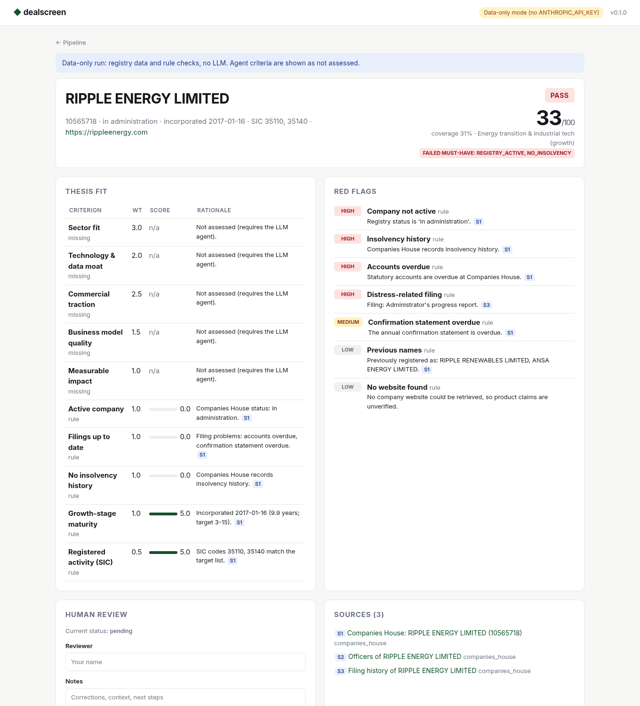
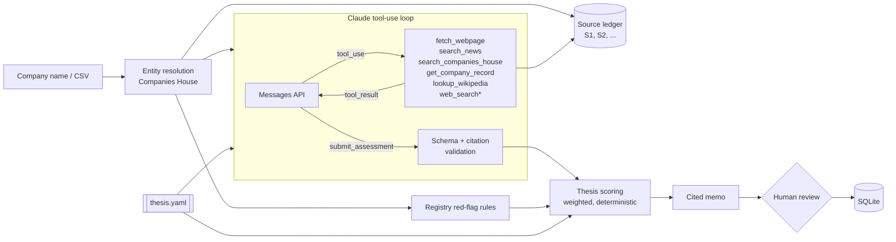
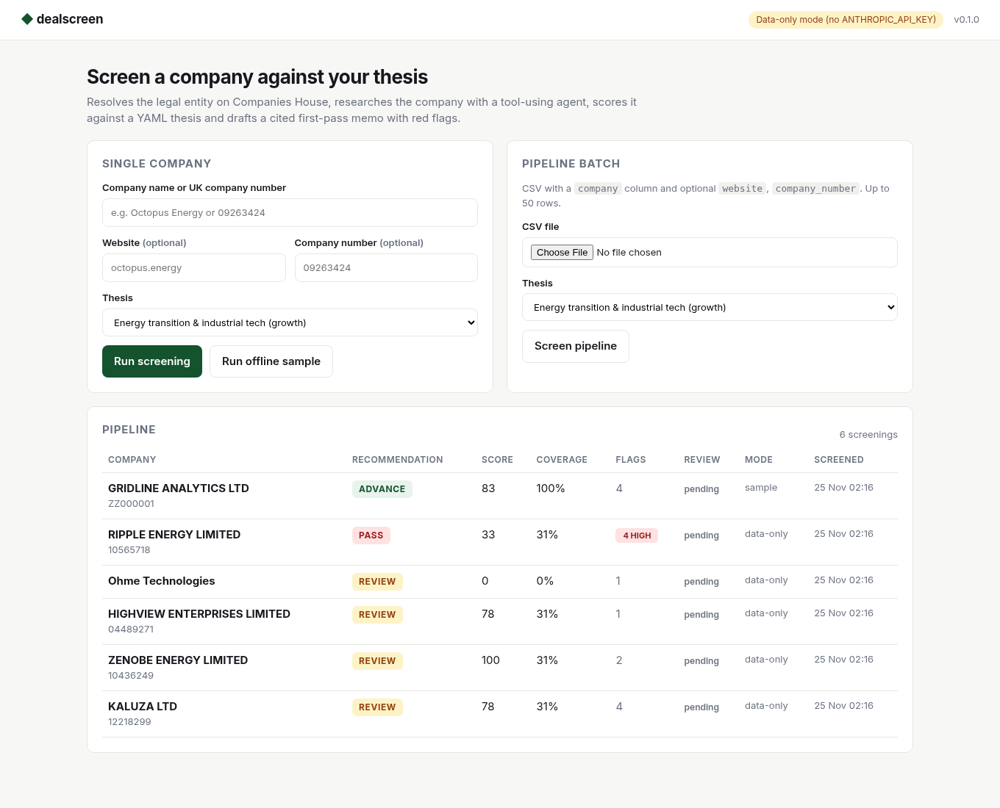

# dealscreen

Agentic deal screening and first-pass due diligence for private-markets investors.

Give it a company name (or a CSV of your pipeline). It resolves the legal entity on Companies House, runs a Claude tool-use agent that researches the company's website, news and competitors, scores the company against an investment thesis you define in YAML, and drafts a first-pass memo in which every fact cites a source it actually retrieved. A human reviewer approves or rejects each screening.



*Live data-only run on a real UK company: registry rules catch an administration and fail the must-have criteria, with no LLM involved.*

## Why

First-pass screening is repetitive: find the legal entity, check the register, read the website, skim the news, map competitors, write it up against the fund's thesis. dealscreen does that first pass so an investor's time goes on the judgement calls. It is deliberately not a black box:

- **The LLM never produces the final score.** It rates individual thesis criteria with cited evidence. Python combines those ratings with deterministic registry checks into a weighted score, an evidence-coverage figure and a recommendation.
- **Citations are checked.** Every retrieved document gets a source id. Claims that cite ids the agent was never given are demoted to "unverified" rather than shown as facts.
- **Registry red flags are rules, not prompts.** Administration, insolvency history, overdue accounts, strike-off notices and officer churn are detected in code, so persuasive website copy can't talk the model out of them.
- **A human signs off.** Every screening starts as `pending` and needs an explicit approve or reject, with notes, before it counts.

## Features

- Web app (FastAPI) with live agent trace over server-sent events, memo view, review workflow and Markdown export
- CLI for single screens, pipeline batches from CSV (ranked `summary.csv` plus one memo per company), listing and review
- Configurable theses in YAML: weighted `agent` criteria with guidance, `rule` criteria over registry data, must-have criteria and thresholds
- Data sources: Companies House (official API with a free key, or the public website as a fallback), company websites, Google News RSS, Wikipedia, and optionally Anthropic's server-side web search
- Safe by default: SSRF guard on every fetch and redirect, untrusted content fenced as data in prompts, per-host rate limits, timeouts and retries, a SQLite HTTP cache, bounded agent turns and API rate limiting
- Degrades gracefully: without `ANTHROPIC_API_KEY` it runs in **data-only mode** (registry, website and rule checks); without a Companies House key it uses the public register website

## Architecture



| Module | Responsibility |
|---|---|
| `http.py` | Timeouts, retries with backoff, per-host rate limiting, SSRF guard, disk cache |
| `sources/` | Companies House (API and public-site backends behind one interface), web, news, Wikipedia |
| `registry.py` | Name matching with a confidence threshold; refuses low-confidence matches |
| `agent.py` | Bounded tool-use loop, forced final submission, validation and self-correction, citation checks |
| `scoring.py`, `redflags.py` | Deterministic scoring and registry rules |
| `pipeline.py` | Orchestration, batch mode with per-row failure isolation |
| `web/`, `cli.py` | FastAPI app and Typer CLI |
| `testing.py` | Offline Messages API harness that plugs into the real `anthropic` SDK |

## Quickstart

Requires Python 3.11+.

```bash
git clone https://github.com/ahyanadatia/dealscreen && cd dealscreen
python -m venv .venv && source .venv/bin/activate
pip install -e ".[dev]"
cp .env.example .env          # add ANTHROPIC_API_KEY to enable the agent

dealscreen demo               # offline sample run: fictional company, no key or network needed
dealscreen serve              # web app on http://127.0.0.1:8000
```

CLI:

```bash
dealscreen doctor                                       # which sources and modes are available
dealscreen screen "Zenobe Energy" -w zenobe.com         # agent mode (needs ANTHROPIC_API_KEY)
dealscreen screen "Ripple Energy" --data-only           # registry + rules only, no LLM
dealscreen batch examples/pipeline.csv --out-dir memos  # ranked summary.csv + one memo each
dealscreen list
dealscreen review <id> approved --notes "Call booked" --reviewer AA
```

Docker:

```bash
docker build -t dealscreen .
docker run -p 8000:8000 --env-file .env -v dealscreen-data:/data dealscreen
```

### Configuration

All settings are environment variables (see `.env.example`). The main ones are `ANTHROPIC_API_KEY`, `DEALSCREEN_MODEL` (default `claude-sonnet-5-5`), `COMPANIES_HOUSE_API_KEY` (free from the [developer hub](https://developer.company-information.service.gov.uk/), recommended), `DEALSCREEN_ANTHROPIC_WEB_SEARCH` and `DEALSCREEN_MAX_TURNS`.

### Writing a thesis

```yaml
name: Energy transition & industrial tech (growth)
description: Growth-stage technology that makes energy systems cleaner and industry more efficient.
thresholds: { advance: 70, review: 50 }
min_coverage: 0.5            # below this share of weight with evidence -> "review"
criteria:
  - id: sector_fit
    label: Sector fit
    weight: 3
    method: agent            # rated 0-5 by the agent, with citations
    must_have: true          # score < 2 forces "pass"
    guidance: Does the core product directly enable decarbonisation or efficiency?
  - id: registry_active
    label: Active company
    weight: 1
    method: rule             # checked in code against Companies House
    must_have: true
    rule: { type: company_active }
```

Rule types: `company_active`, `no_insolvency`, `filings_current`, `age_years` (`min`/`max`), `sic_prefix` (`prefixes`). See `theses/` for two complete examples.

## Testing

```bash
pytest            # 57 tests, fully offline
ruff check . && mypy src
```

The suite never calls the live Anthropic API. Scripted model responses are served to the real `anthropic` SDK through a mock transport, so the SDK's own request building and response parsing run unchanged. Each request is checked against the Messages API contract the agent relies on: alternating roles, every `tool_use` answered by a matching `tool_result`, self-contained tool schemas, and thinking blocks echoed back with their signatures intact. Companies House parsers are tested against saved copies of real public register pages.

## Examples

- [`examples/live-data-only/`](examples/live-data-only/): a live data-only batch over five real UK energy companies (registry, website and rules; no LLM)
- [`examples/SAMPLE-agent-memo-fictional-company.md`](examples/SAMPLE-agent-memo-fictional-company.md): **sample output** of `dealscreen demo` (fictional company, scripted model responses) showing the agent-mode memo format



## Design trade-offs

- **Deterministic scoring over LLM scoring.** Asking the model for one overall score is simpler but unauditable and unstable between runs. Splitting it into per-criterion ratings with evidence, weighted in code, makes scores explainable and lets the team tune weights without re-prompting.
- **Registry first, then the agent.** Resolving the entity in code before the agent starts keeps the common case cheap and grounded. The agent can still correct the entity, but only to a company number it retrieved.
- **Refusing weak matches.** A wrong entity is worse than no entity in diligence, so below a name-similarity threshold the tool asks for a company number rather than guessing.
- **Public-site fallback for Companies House.** It keeps the tool usable with zero setup, at the cost of HTML parsing that could break if the site changes. The official API backend is preferred and shares the same models.
- **Synchronous core with a thread pool.** Simpler to reason about and test than async throughout. Concurrency is bounded per batch and in the web app, which also respects upstream rate limits.
- **SQLite and in-process jobs.** Fine for a single team on one machine. A multi-user deployment would move jobs to a queue and results to Postgres.
- **Prompt-injection posture.** Retrieved text is fenced and labelled as data, tools are read-only, URLs pass an SSRF guard, and the score can't be set by the model directly. This reduces the risk but doesn't eliminate it, which is one reason a human review step is built in.

## Limitations

- UK-centric registry coverage. Non-UK companies fall back to web evidence only.
- No financial statement parsing yet. Accounts are tracked as dates and filing types, not figures.
- Google News RSS gives headlines only, which the agent treats as leads rather than verified facts.

## License

MIT
